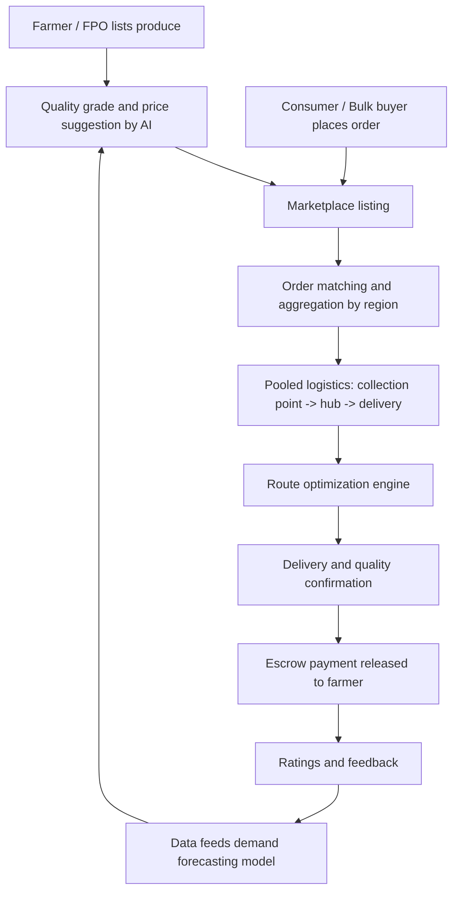

# Smart India Hackathon Workshop
# Date: 24/10/2026
## Reference Number: 26018292
## Name: Darun Goppi G

## Problem Title
SIH 26033: Multiple intermediaries reduce farmers earnings and increase consumer prices.

## Problem Creater's Organization
Ministry of Consumer Affairs, Food & Public Distribution

## Theme
Agriculture, FoodTech & Rural Development

## Problem Description
Expected Solution: Create a digital marketplace that:

• Connects farmers/FPOs directly with consumers and bulk buyers.
• Provides logistics support.
• Uses AI for demand forecasting and route optimization.

Benefits:

• Better prices for farmers.
• Lower prices for consumers.
• Reduced supply chain inefficiencies.

## Proposed Solution

### 1. Detailed explanation of the proposed solution

**FarmLink** is a farm-to-consumer digital marketplace (mobile app + web portal) that lets farmers and Farmer Producer Organizations (FPOs) list produce and sell it directly to households, retailers, restaurants, and bulk buyers such as institutions and processors.

Core modules:

- **Farmer / FPO app:** simple, multilingual (voice and icon-driven) interface to list crops, quantity, quality grade, expected harvest date, and price. Farmers can accept orders, track payments, and see live market price trends.
- **Buyer app and portal:** consumers and bulk buyers browse produce by location, freshness, and farmer rating, place one-time or subscription orders, and place bulk or forward contracts.
- **Logistics layer:** aggregation of orders from nearby farms into village or cluster collection points, then pooled transport to local hubs and delivery partners.
- **AI engine:** demand forecasting, price recommendation, and route optimization (details in the Technical Approach).
- **Payments and trust:** UPI-based payments with escrow, released on confirmed delivery, plus quality checks and a rating system for farmers and buyers.
- **Admin dashboard:** for government and FPO officials to monitor prices, volumes, and supply gaps.

### 2. How it addresses the problem

| Problem today | How FarmLink addresses it |
|---|---|
| Several layers of middlemen (commission agents, traders, wholesalers, retailers) each add margin | Direct farmer-to-buyer listing and ordering removes most intermediary layers |
| Farmers lack price information and bargaining power | Transparent price display, AI price suggestions, and mandi benchmark rates |
| Farmers produce without knowing demand, causing gluts and shortages | Demand forecasting guides crop and sales planning |
| Perishables spoil and transport is costly and fragmented | Order pooling and route optimization raise vehicle utilization and cut transit time |
| Delayed or uncertain payments | Escrow-based digital payments released promptly after delivery |

### 3. Innovation and uniqueness of the solution

- **Demand-led selling:** forecasts shared with farmers before and during the season, not only a listing board.
- **Cluster-based pooled logistics:** small farmers share transport, making direct sales viable at low volumes.
- **Dynamic, fair price recommendation:** balances mandi benchmarks, forecast demand, and quality grade so both sides see a fair price.
- **Low-literacy, low-connectivity design:** vernacular voice interface, offline listing that syncs later, and an SMS/IVR fallback.
- **FPO-first model:** FPOs act as aggregators, giving buyers consistent quality and volume.
- **Open integration:** designed to plug into existing public systems (e-NAM, Agmarknet, ONDC) instead of replacing them.

## Technical Approach

### 1. Technologies to be used

| Layer | Technology |
|---|---|
| Mobile app | Flutter or React Native (Android first, multilingual, offline support) |
| Web portal / admin | React.js, Tailwind CSS |
| Backend | Node.js (Express) or Python (FastAPI), REST APIs |
| Database | PostgreSQL (+ PostGIS for geospatial queries), Redis for caching |
| AI / ML | Python, scikit-learn, XGBoost, Prophet / LSTM for time-series forecasting; Google OR-Tools for route optimization |
| Speech / language | Speech-to-text and translation APIs (e.g., Bhashini) for vernacular voice input |
| Payments | UPI gateway with escrow flow |
| Maps / routing | OpenStreetMap or Google Maps API |
| Notifications | Firebase Cloud Messaging, SMS gateway |
| Cloud / DevOps | Docker, GitHub Actions CI/CD, cloud hosting (AWS / Azure / GCP or NIC cloud) |
| Data sources | Agmarknet / e-NAM price data, IMD weather data, historical order data |

### 2. Methodology and process for implementation

**Implementation phases**

1. **Research and design:** farmer and buyer interviews, requirement finalization, UI prototypes.
2. **MVP build:** listing, ordering, payments, and basic delivery tracking for 2-3 crops in one district.
3. **AI integration:** train demand and price models on historical mandi data; add route optimization.
4. **Pilot:** onboard a few FPOs and local buyers, collect feedback, fix issues.
5. **Scale:** expand crops and regions, integrate with e-NAM / ONDC, add government dashboard.

*(Add flow chart images, wireframes, or a working-prototype link here.)*

## Feasibility and Viability

### 1. Analysis of the feasibility of the idea

- **Technical:** all components (marketplace, payments, ML forecasting, routing) use mature, available technology.
- **Operational:** existing FPOs, self-help groups, and village-level entrepreneurs can serve as aggregation points.
- **Economic:** revenue through a small transaction fee, logistics margin, and premium services, while still leaving farmers a larger share than the traditional chain.
- **Adoption:** growing smartphone and UPI penetration in rural areas supports digital onboarding.
- **Policy fit:** aligns with government initiatives such as e-NAM, FPO promotion schemes, and ONDC.

### 2. Potential challenges and risks

- Low digital literacy and patchy internet connectivity in rural areas.
- Trust issues: farmers wary of new platforms, buyers wary of quality consistency.
- Perishability and last-mile delivery costs for small orders.
- Cold start problem: needs enough farmers and buyers at the same time.
- Resistance from existing middlemen and local market dynamics.
- Limited or inconsistent historical data for forecasting.

### 3. Strategies for overcoming these challenges

- Voice-based vernacular UI, offline mode, and SMS/IVR fallback; local field agents for onboarding and training.
- Standard quality grading, photo verification, ratings, and escrow payments to build trust.
- Cluster-based pooling and scheduled delivery slots to lower per-order logistics costs; partner with cold-chain providers for perishables.
- Start with a single district and a few high-volume crops, working through FPOs to seed supply and demand together.
- Involve local traders as logistics or aggregation partners rather than excluding them.
- Begin with public price data and improve models continuously as platform data grows.

## Impact and Benefits

### 1. Potential impact on the target audience

- **Farmers / FPOs:** higher realized prices, faster payments, better planning through demand and price insights, wider market access.
- **Consumers:** fresher produce at lower prices with transparent sourcing.
- **Bulk buyers (restaurants, retailers, institutions, processors):** reliable supply, consistent quality, and contract options.
- **Government:** real-time data on prices, supply, and demand to support policy and food-security planning.

### 2. Benefits of the solution (social, economic, environmental, etc.)

- **Economic:** a larger share of the consumer price reaches the farmer; lower end prices for consumers; reduced supply chain inefficiencies.
- **Social:** empowers small and marginal farmers and FPOs, promotes digital and financial inclusion in rural areas, and creates local jobs in aggregation and delivery.
- **Environmental:** less food waste through demand-matched supply and shorter transit time, and fewer vehicle trips through route optimization and load pooling.
- **Governance:** transparent price discovery and data-driven decision-making.

## Research and References

- e-NAM (National Agriculture Market): https://enam.gov.in
- Agmarknet (agricultural market price data): https://agmarknet.gov.in
- ONDC (Open Network for Digital Commerce): https://ondc.org
- Bhashini (Indian language technology): https://bhashini.gov.in
- Ministry of Consumer Affairs, Food & Public Distribution: https://consumeraffairs.nic.in
- Department of Agriculture & Farmers Welfare, FPO scheme: https://agriwelfare.gov.in
- Google OR-Tools (vehicle routing): https://developers.google.com/optimization/routing
- Prophet (time-series forecasting): https://facebook.github.io/prophet/

